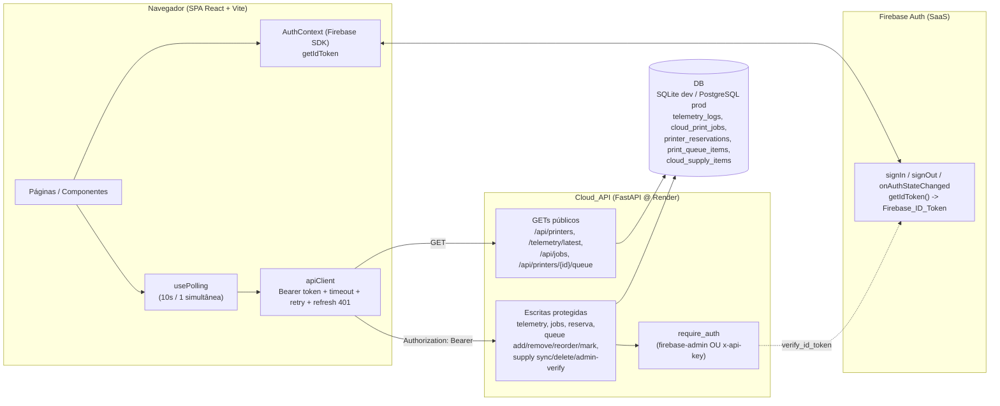
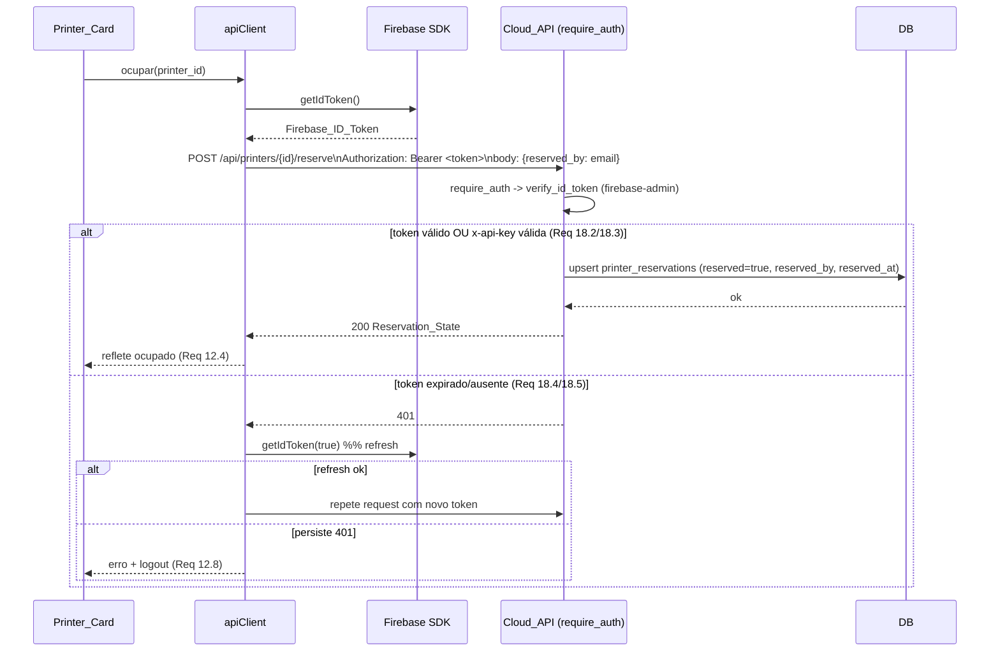
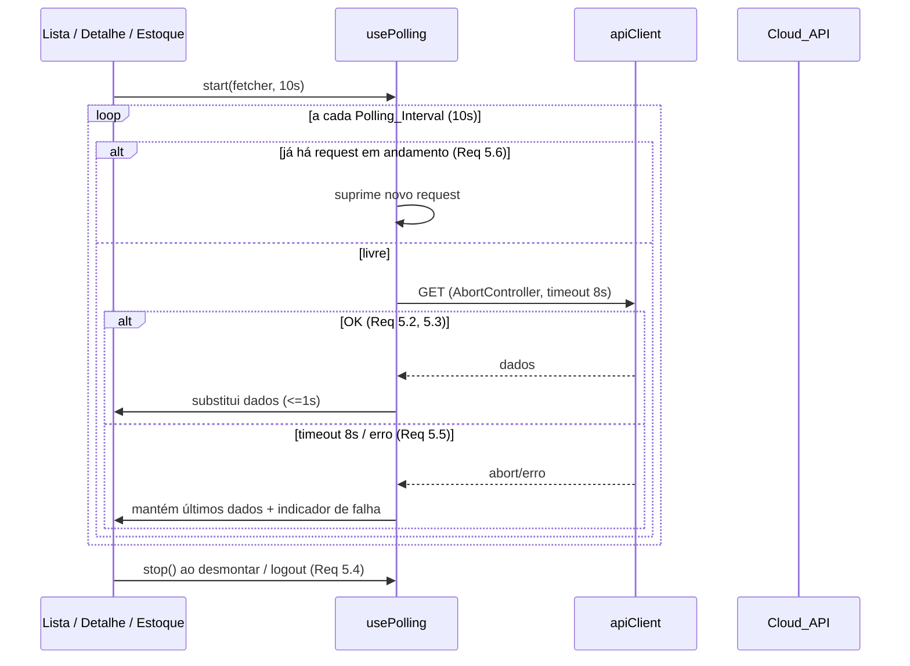

# Design Document

## Overview

Esta feature transforma o PrintDeck em uma plataforma web de gestão da frota de impressoras 3D,
composta por um **Dashboard** (SPA React + Vite isolado em `web_dashboard/`) e por extensões da
**Cloud_API** FastAPI existente. O escopo cobre as Requirements 1 a 18 e substitui integralmente
o design anterior (que cobria apenas o dashboard read-only).

Capacidades entregues:

1. **Listagem de impressoras com status, modelo e reserva (Req 1, 9):** um novo
   **Printer_List_Endpoint** `GET` público que retorna, por `printer_id` distinto, o
   **Telemetry_Record** mais recente — agora incluindo o campo `model` e o **Reservation_State**
   (`reserved`, `reserved_by`, `reserved_at`).

2. **Disponibilidade e staleness (Req 3, 4, 10):** o Dashboard exibe cada impressora em um
   **Printer_Card** com indicador de frescor (atualizado/desatualizado/offline) e um
   **Availability_State** (verde = `disponível` / vermelho = `indisponível`) que leva em conta a
   reserva manual, o `state` de telemetria e o Staleness_Threshold. Inclui o **Model_Filter**.

3. **Reserva manual compartilhada (Req 11, 12):** endpoints de escrita na Cloud_API para **ocupar**
   e **liberar** impressoras por `printer_id`, persistidos de forma durável e compartilhada entre o
   Dashboard e o app Flutter. O Dashboard reserva/libera enviando `Authorization: Bearer <token>`.

4. **Fila de impressão por impressora (Req 13, 14):** nova tabela `print_queue_items` e endpoints
   GET (público) + add/remove/reorder/mark-printed (protegidos), com invariante de posições únicas
   e contíguas. O Dashboard exibe/edita a **Print_Queue** compartilhada. Upload de arquivo é fase
   futura, fora do escopo.

5. **Estoque compartilhado (Req 15, 16, 17):** o Dashboard **consome** os endpoints de Supply já
   existentes (`GET /api/supply/items`, `POST /api/supply/sync`, `DELETE /api/supply/items/{item_id}`,
   `POST /api/supply/admin/verify`), agora autorizados por JWT, com visualização, CRUD baseado em
   posse (`owner_id` = e-mail) e **Admin_Mode** via `x-admin-code`.

6. **Autenticação e autorização por JWT do Firebase (Req 2, 18):** a Cloud_API passa a validar o
   **Firebase_ID_Token** com o firebase-admin SDK e aplica a política de **API_Authorization**: um
   endpoint protegido autoriza quando a requisição apresenta um token válido **OU** uma `x-api-key`
   válida. O frontend nunca conhece a `x-api-key`; autoriza-se apenas pelo token.

### Objetivos

- Expor a frota completa (último status + modelo + reserva) em um único request público (Req 1, 9).
- Autenticar o acesso ao Dashboard via Firebase_Auth e proteger rotas (Req 2).
- Exibir status, disponibilidade (verde/vermelho), filtro por modelo e detalhe com histórico de jobs,
  fila e reserva (Req 3, 4, 6, 10).
- Permitir reservar/liberar impressoras e gerenciar a fila de impressão compartilhada (Req 11–14).
- Visualizar e gerenciar o estoque compartilhado com posse e Admin_Mode (Req 15–17).
- Proteger a Cloud_API com JWT do Firebase mantendo compatibilidade com `x-api-key` (Req 18).
- Atualizar por polling de 10s, com no máximo 1 request simultânea, tratando Cold_Start (Req 5, 7).
- Entregar um projeto isolado, configurável por env, sem `x-api-key` no frontend (Req 8).

### Não-objetivos

- Nenhum comando de controle/operação de impressão (iniciar/parar/temperatura) — o Dashboard só
  visualiza e reserva (Req 3.8).
- Upload/armazenamento de arquivos da fila (`.gcode`/`.3mf`/`.stl`) — fase futura (Req 14.13).
- Separar inventário por usuário — o Supply_Inventory é único e compartilhado (Req 15–17).
- Provisionamento de nova infraestrutura; a Cloud_API continua no Render.

## Architecture

### Visão de componentes



**Decisão (Req 18):** diferente do design anterior (em que a API era totalmente pública e a proteção
vivia só no frontend), agora a Cloud_API **valida o JWT do Firebase** via firebase-admin e aplica
API_Authorization nos endpoints de escrita e nas leituras protegidas de estoque. Os GETs de
telemetria/jobs/printers/queue permanecem públicos (Req 1.10, 13.4, 14). O firebase-admin verifica o
`Firebase_ID_Token`; se as credenciais da service account não estiverem configuradas, a verificação
de token falha e só `x-api-key` autoriza (degradação segura, Req 18.8). Risco documentado: dados de
telemetria/fila permanecem publicamente legíveis por exigência explícita (Req 1.10, 13.4).

### Fluxo de login e obtenção de token (Req 2, 18)

```mermaid
sequenceDiagram
    participant U as Usuário
    participant SPA as Dashboard SPA
    participant FB as Firebase_Auth

    U->>SPA: abre rota protegida
    SPA->>FB: onAuthStateChanged (restaura sessão persistida)
    alt sessão válida (Req 2.9)
        FB-->>SPA: user != null
        SPA->>FB: getIdToken() -> Firebase_ID_Token
        SPA-->>U: renderiza app autenticada
    else sem sessão (Req 2.10)
        FB-->>SPA: user == null
        SPA-->>U: redireciona para /login
        U->>SPA: email + senha
        SPA->>SPA: valida formato localmente (Req 2.3)
        SPA->>FB: signInWithEmailAndPassword (timeout 10s, Req 2.6)
        alt válidas (Req 2.4)
            FB-->>SPA: user + ID token
            SPA-->>U: app autenticada (<=5s)
        else rejeitadas (Req 2.5) / timeout (Req 2.6)
            FB-->>SPA: erro
            SPA-->>U: mensagem; preserva email; fica em /login
        end
    end
```

### Fluxo de uma escrita autenticada (ex.: ocupar impressora — Req 11, 12, 18)



### Fluxo de polling (Req 5)



### Stack e dependências

- **Backend:** FastAPI + SQLAlchemy async (existente); adicionar **firebase-admin** (Python) ao
  `cloud_api/requirements.txt` para validar o ID token.
- **Frontend:** React 18 + Vite + TypeScript + react-router-dom + firebase (JS SDK, `firebase/auth`).
  Fetch API + AbortController (sem lib HTTP extra).
- **Testes:** backend `pytest` + `pytest-asyncio` + `httpx.AsyncClient` + `hypothesis`; frontend
  `Vitest` + React Testing Library + `fast-check`.

## Components and Interfaces

### Backend — organização

As extensões backend são agrupadas por área. Todos os handlers de escrita passam a depender da nova
dependency `require_auth` (seção f). Em produção o Render roda `uvicorn app.main:app`, então tudo deve
estar registrado em `app/main.py` ou em routers incluídos por ele.

#### a. Printer_List_Endpoint com modelo e reserva (Req 1, 9.7)

Novo handler público em `app/main.py`:

```python
@app.get("/api/printers", response_model=list[PrinterOut])
async def list_printers(db: AsyncSession = Depends(get_db)):
    ...
```

- **Público** (Req 1.10): sem `Depends(require_auth)`.
- **Latest por printer_id compatível SQLite + PostgreSQL** (Req 1.2, 1.3): reaproveita a estratégia
  do design anterior — subquery de agregação `max(created_at)` por `printer_id` e desempate por
  `max(id)`, evitando window functions e `DISTINCT ON`.

```python
from sqlalchemy import func, select

latest_ts = (
    select(PrinterTelemetry.printer_id.label("pid"),
           func.max(PrinterTelemetry.created_at).label("max_ts"))
    .group_by(PrinterTelemetry.printer_id)
    .subquery()
)
latest_id = (
    select(func.max(PrinterTelemetry.id).label("max_id"))
    .join(latest_ts,
          (PrinterTelemetry.printer_id == latest_ts.c.pid)
          & (PrinterTelemetry.created_at == latest_ts.c.max_ts))
    .group_by(PrinterTelemetry.printer_id)
    .scalar_subquery()
)
query = (
    select(PrinterTelemetry)
    .where(PrinterTelemetry.id.in_(latest_id))
    .order_by(PrinterTelemetry.created_at.desc())
)
```

- **Junção da reserva (Req 1.7, 1.8):** após obter as linhas de telemetria vencedoras, carregar as
  reservas correspondentes (`select(PrinterReservation).where(printer_id.in_(ids))`) e montar um
  `dict` por `printer_id`. Para cada impressora sem linha de reserva, aplicar o default
  `reserved=False, reserved_by=None, reserved_at=None`. (Alternativa equivalente: LEFT OUTER JOIN em
  `printer_reservations`; a opção de lookup em memória evita colunas ambíguas com o schema e é
  suficiente para o volume da frota.)
- **Resposta (Req 1.4–1.8):** novo schema `PrinterOut` combinando `TelemetryOut` + `model` +
  Reservation_State. Campos nulos (`current_file`, `filament_info`, `model`) serializados como `null`.
- **Lista vazia** (Req 1.9): `[]` com 200. **Erro de DB** (Req 1.11): `try/except` → `HTTPException(500)`
  sem escrita. **Desempenho** (Req 1.12): consulta indexada por `printer_id`/`created_at`.

#### b. Coluna `model` + auto-migração (Req 9)

- **Modelo (Req 9.1):** adicionar `model = Column(String, nullable=True)` em `PrinterTelemetry`.
- **Auto-migração idempotente (Req 9.2, 9.3, 9.11):** estender o padrão `_ensure_supply_schema`
  (criar `_ensure_telemetry_schema`) chamado no `lifespan`, cobrindo PostgreSQL
  (`ADD COLUMN IF NOT EXISTS`) e SQLite (`PRAGMA table_info` + `ADD COLUMN` condicional), com
  `try/except` que loga e segue sem derrubar o boot.

```python
async def _ensure_telemetry_schema(conn):
    dialect = conn.dialect.name
    try:
        if dialect == "postgresql":
            await conn.exec_driver_sql(
                "ALTER TABLE telemetry_logs ADD COLUMN IF NOT EXISTS model VARCHAR")
        elif dialect == "sqlite":
            rows = await conn.exec_driver_sql("PRAGMA table_info(telemetry_logs)")
            cols = [r[1] for r in rows.fetchall()]
            if "model" not in cols:
                await conn.exec_driver_sql("ALTER TABLE telemetry_logs ADD COLUMN model VARCHAR")
        else:
            await conn.exec_driver_sql("ALTER TABLE telemetry_logs ADD COLUMN model VARCHAR")
    except Exception:
        logger.warning("Falha ao migrar coluna model; seguindo o boot")  # Req 9.11
```

- **Schemas (Req 9.4–9.9):** `TelemetryIn.model: str | None = None` (opcional); `TelemetryOut.model:
  str | None`. `POST /api/telemetry` passa a persistir `model` (null quando omitido). Registros antigos
  retornam `model=None` sem erro (Req 9.9). `GET /api/telemetry/latest/{printer_id}` passa a usar
  `PrinterOut` para também expor `model` + Reservation_State (Req 9.7, 9.10).

#### c. Reserva manual (Req 11)

**Decisão de dados:** usar **nova tabela `printer_reservations`** criada via `create_all`, e não
colunas em `telemetry_logs`. Justificativa: cada `printer_id` tem histórico de muitas linhas em
`telemetry_logs`; colocar reserva lá exigiria replicar/atualizar reserva em toda inserção de
telemetria e complicaria o "latest". Uma tabela dedicada com uma linha por `printer_id` dá estado de
reserva único, durável e compartilhado (Req 11.5), e dispensa auto-migração de colunas (Req 11.6 só
se aplica se fossem colunas) — `create_all` basta.

Endpoints (protegidos por `require_auth`, Req 11.7):

```python
@app.post("/api/printers/{printer_id}/reserve", response_model=ReservationOut,
          dependencies=[Depends(require_auth)])
async def reserve_printer(printer_id: str, body: ReserveIn,
                          identity: Identity = Depends(require_auth),
                          db: AsyncSession = Depends(get_db)): ...

@app.post("/api/printers/{printer_id}/release", response_model=ReservationOut,
          dependencies=[Depends(require_auth)])
async def release_printer(printer_id: str, db: AsyncSession = Depends(get_db)): ...
```

- **Ocupar (Req 11.3, 11.8, 11.11):** upsert em `printer_reservations` com `reserved=True`,
  `reserved_at=utcnow()`, e `reserved_by` = `identity.email` (das claims do token) quando disponível,
  senão o `reserved_by` do corpo. Reservar impressora já reservada substitui os valores e responde 200.
- **`reserved_by` obrigatório (Req 11.10):** se o corpo omite/vazio `reserved_by` **e** não há email no
  token → `HTTPException(422)` sem alterar estado.
- **Liberar (Req 11.4, 11.12):** upsert com `reserved=False, reserved_by=None, reserved_at=None`;
  liberar impressora não reservada responde 200 mantendo não reservado.
- **404 (Req 11.13):** se `printer_id` não existe em `telemetry_logs`, responder 404 sem criar reserva
  (`select(exists)` por `printer_id` em `telemetry_logs`).
- **401 (Req 11.9):** garantido por `require_auth`.
- **Leitura (Req 11.14):** o Reservation_State é lido publicamente via `/api/printers` (seção a).

#### d. Fila de impressão (Req 13)

**Nova tabela `print_queue_items`** criada via `create_all` (Req 13.19), colunas `id`, `printer_id`
(index), `sku`, `name`, `position`, `created_at`, `created_by`. `printer_id` é tratado logicamente
como texto (Req 13.21): a fila opera mesmo que o `printer_id` não exista em `telemetry_logs`.

Endpoints:

```python
# GET público (Req 13.1-13.4)
@app.get("/api/printers/{printer_id}/queue", response_model=list[QueueItemOut])
async def get_queue(printer_id: str, db=Depends(get_db)): ...  # ordem por position asc

# Escritas protegidas (Req 13.5-13.18, require_auth)
@app.post("/api/printers/{printer_id}/queue", ..., dependencies=[Depends(require_auth)])
async def add_queue_item(printer_id, body: QueueAddIn, identity=Depends(require_auth), db=...): ...
@app.delete("/api/printers/{printer_id}/queue/{item_id}", ..., dependencies=[Depends(require_auth)])
async def remove_queue_item(printer_id, item_id, db=...): ...
@app.post("/api/printers/{printer_id}/queue/reorder", ..., dependencies=[Depends(require_auth)])
async def reorder_queue(printer_id, body: QueueReorderIn, db=...): ...
@app.post("/api/printers/{printer_id}/queue/{item_id}/mark-printed", ...,
          dependencies=[Depends(require_auth)])
async def mark_printed(printer_id, item_id, db=...): ...
```

- **GET (Req 13.1–13.4):** retorna Queue_Items por `printer_id` ordenados por `position` asc; fila
  vazia → `[]` com 200; público.
- **Add (Req 13.5–13.7):** `position = max(position)+1` da fila (ou primeira posição se vazia);
  `created_by` = email do token quando disponível, senão corpo; `sku` vazio → 422.
- **Remove (Req 13.10–13.12):** 404 se `id` inexistente; ao remover, **reindexar** posições restantes
  mantendo ordem relativa, únicas e contíguas.
- **Reorder (Req 13.13–13.15):** recebe lista ordenada de `id`; se a lista não corresponder
  exatamente ao conjunto atual de `id` da fila (id desconhecido ou inconsistente) → 422 sem alterar;
  senão atribui `position` conforme a ordem recebida.
- **Mark-printed (Req 13.16–13.18):** 404 se `id` inexistente; remove da fila ativa e reindexa igual
  ao remove.
- **Invariante (Req 13.22):** após qualquer operação, as `position` de uma mesma fila são únicas e
  contíguas (0..n-1 ou 1..n — padronizar em 1..n), e o item de menor `position` é o próximo a imprimir.
- **401 (Req 13.8/13.9):** garantido por `require_auth` nas escritas.

Helper de reindexação (usado por remove/mark-printed):

```python
def reindex(items_sorted_by_position):  # ordem relativa preservada
    for new_pos, item in enumerate(items_sorted_by_position, start=1):
        item.position = new_pos
```

#### e. Estoque — apenas autorização (Req 15, 16, 17)

Os endpoints de supply **já existem** em `routers/supply.py` e **não** são recriados. Mudança única:
trocar a dependency `verify_secret` (apenas `x-api-key`) pela nova `require_auth` (JWT **OU**
`x-api-key`) em `/items`, `/sync`, `/items/{item_id}` e `/admin/verify`, mantendo a lógica de posse e
admin intacta.

- **Mapeamento identidade → device_id/owner_id:** o Dashboard envia `device_id` (no corpo do `/sync`
  ou query do `/delete`/`/items`) igual ao **e-mail** do Authenticated_User. O servidor segue usando
  `device_id` como `acting_device_id` e, em inserts, como `owner_id` (Req 16 posse por e-mail). Quando
  a requisição vem por token, o email das claims deve ser preferido como `device_id` efetivo se o
  corpo divergir — para consistência, a dependency expõe `identity.email`, e o handler de `/sync` usa
  `identity.email or data.device_id`. O comportamento de `forbidden` (Req 16.10), 403 (Req 16.12) e
  404 (Req 16.13) permanece o do código atual.
- **Admin_Mode (Req 17):** `is_admin` continua lendo `x-admin-code`; `/admin/verify` segue retornando
  200/403. O token e o `x-admin-code` são enviados juntos; `x-api-key` nunca.

#### f. Dependency de autenticação `require_auth` (Req 18)

Nova dependency em `app/core/auth.py`, composta e reutilizável, que **substitui** `verify_secret` nos
endpoints protegidos (telemetry POST, jobs POST, reserva, fila-escritas, supply sync/delete/admin).

```python
# app/core/auth.py
@dataclass
class Identity:
    email: str | None
    uid: str | None
    via: str  # "firebase" | "api_key"

def require_auth(
    authorization: str | None = Header(default=None),
    x_api_key: str | None = Header(default=None),
) -> Identity:
    # 1) tenta Firebase_ID_Token (Req 18.1, 18.2)
    if authorization and authorization.lower().startswith("bearer "):
        token = authorization.split(" ", 1)[1]
        claims = _verify_firebase_token(token)   # None se inválido/sem credenciais
        if claims is not None:
            return Identity(email=claims.get("email"), uid=claims.get("uid"), via="firebase")
    # 2) fallback x-api-key (Req 18.3)
    if settings.API_SECRET_KEY and settings.API_SECRET_KEY != "disabled" \
            and x_api_key == settings.API_SECRET_KEY:
        return Identity(email=None, uid=None, via="api_key")
    # 3) nenhum autoriza (Req 18.4, 18.5)
    raise HTTPException(status_code=401, detail="Não autorizado")
```

- **Verificação do token (Req 18.1, 18.5):** `_verify_firebase_token` chama
  `firebase_admin.auth.verify_id_token(token)`; token expirado/malformado/assinatura inválida →
  retorna `None` (não autoriza por token). Deriva `email`/`uid` das claims (Req 18.2).
- **Inicialização do firebase-admin (Req 18.7):** no startup, inicializar o app firebase-admin a
  partir de credenciais da service account em variável de ambiente
  (`FIREBASE_SERVICE_ACCOUNT_JSON` com o JSON inline, ou `GOOGLE_APPLICATION_CREDENTIALS` apontando
  para o arquivo), coerente com o Render. Adicionar `FIREBASE_SERVICE_ACCOUNT_JSON` em
  `core/config.py`.
- **Degradação segura (Req 18.8):** se as credenciais não estiverem configuradas, não inicializar o
  firebase-admin; `_verify_firebase_token` sempre retorna `None` (toda validação de token falha) e
  apenas `x-api-key` autoriza; logar a condição uma vez no startup.
- **401 (Req 18.4):** sem token válido e sem `x-api-key` válida → 401, sem efeito colateral.
- **`x-api-key` só no backend (Req 18.6):** nunca exposta ao frontend; documentada apenas em config de
  servidor.
- **requirements.txt:** adicionar `firebase-admin>=6.5.0` em `cloud_api/requirements.txt`.

Composição: os endpoints protegidos trocam `dependencies=[Depends(verify_secret)]` por
`dependencies=[Depends(require_auth)]`; quando precisam da identidade (reserva, fila-add, supply-sync),
recebem `identity: Identity = Depends(require_auth)` como parâmetro.

### Frontend — componentes e serviços (web_dashboard/)

| Componente / serviço | Responsabilidade | Requisitos |
|---|---|---|
| `main.tsx` + `config/env.ts` | Bootstrap; valida env (URL + Firebase) antes de montar; aborta com mensagem se faltar | 8.2–8.5 |
| `config/firebase.ts` | `initializeApp` + `getAuth` | 8.4 |
| `App` + router | Rotas client-side (`/login`, `/`, `/printers/:id`, `/supply`) sem recarregar | 8.6 |
| `auth/AuthContext` | Firebase_Auth: `login`, `logout`, `user`, `initializing`, `getToken(force?)` | 2.2, 2.4–2.10, 18 |
| `auth/ProtectedRoute` | Bloqueia rotas sem sessão → `/login` | 2.1, 2.10 |
| `pages/LoginPage` | Form email/senha, validação local, erros, preserva email | 2.2, 2.3, 2.5, 2.6 |
| `components/AppLayout` | Casca autenticada, navegação (impressoras/estoque), logout | 2.7, 2.8 |
| `pages/PrinterListPage` | Polling da lista, loading/erro/vazio, Model_Filter, grid | 3.x, 5.x, 7.x, 10.x |
| `components/ModelFilter` | Seleção de modelo / todas / "sem modelo" | 10.x |
| `components/PrinterGrid` + `PrinterCard` | Grid e card com campos, modelo, indicador de frescor, Availability_State (verde/vermelho), rótulo e controle de reserva | 3.2–3.5, 4.x, 12.1–12.10 |
| `pages/PrinterDetailPage` | Status (polling) + Job_History + reserva + Print_Queue | 6.x, 12.x, 14.x |
| `components/JobHistoryList` | Itens de Job_History | 6.3, 6.4 |
| `components/PrintQueuePanel` | Exibe/adiciona/reordena/remove/marca-impresso; destaque do próximo | 14.x |
| `components/ReservationControls` | Botão ocupar/liberar; exibe `reserved_by`/`reserved_at` | 12.x |
| `pages/SupplyPage` | Lista/CRUD do estoque, indicadores is_bought, posse, Admin_Mode | 15.x, 16.x, 17.x |
| `components/AdminModeControl` | Informar/validar `x-admin-code`, entrar/sair do Admin_Mode | 17.x |
| `api/client.ts` (`apiClient`) | fetch com timeout/abort, injeta `Authorization: Bearer`, trata 401 (refresh → logout), retry Cold_Start | 7.x, 18, 12.3, 14.6 |
| `api/printersApi.ts` | `getPrinters`, `getLatestTelemetry`, `getJobHistory` (públicos) | 1, 3, 6 |
| `api/reservationApi.ts` | `reserve`, `release` (Bearer) | 11, 12 |
| `api/queueApi.ts` | `getQueue` (público), `addItem`, `remove`, `reorder`, `markPrinted` (Bearer) | 13, 14 |
| `api/supplyApi.ts` | `listItems`, `sync`, `deleteItem`, `verifyAdmin` (Bearer + opcional x-admin-code) | 15, 16, 17 |
| `hooks/usePolling.ts` | Polling 10s, 1 simultânea, para ao desmontar | 5.x |
| `lib/availability.ts` | Funções puras de staleness e Availability_State | 4.x |

#### apiClient (Req 7, 18)

```ts
interface RequestOptions {
  timeoutMs: number;          // 8000 polling; 60000 cold start
  signal?: AbortSignal;
  auth?: boolean;             // injeta Authorization: Bearer <token>
  adminCode?: string;         // x-admin-code quando em Admin_Mode (Req 17.3)
}

// Injeta token, trata 401 renovando o token uma vez; se persistir, desloga (Req 18, 12.8)
async function request<T>(path: string, init: RequestInit, opts: RequestOptions): Promise<T>;

interface ColdStartOptions { maxAttempts: 3; retryDelayMs: 10000; perAttemptTimeoutMs: 60000; }
async function withColdStartRetry<T>(fn: () => Promise<T>, o: ColdStartOptions): Promise<T>;
```

- Base URL de `import.meta.env.VITE_CLOUD_API_URL` (Req 8.2). **Nunca** envia `x-api-key` (Req 8.7, 8.8).
- Em `auth: true`, obtém o token via `getToken()` (Firebase `getIdToken()`); em 401, chama
  `getToken(true)` (`getIdToken(true)`) e repete uma vez; novo 401 → `logout()` (Req 18.5, 12.8).
- Timeout por request via `AbortController`; Cold_Start com 3 tentativas a 10s e janela de 60s
  (Req 7.2–7.4). Erros tipados (`ApiError`) distinguem rede, `AbortError` e status HTTP (Req 7.1).

#### AuthContext (Req 2, 18)

```ts
interface AuthState {
  user: FirebaseUser | null;
  initializing: boolean;                 // enquanto onAuthStateChanged não resolveu (Req 2.9)
  login(email: string, password: string): Promise<void>;  // timeout 10s (Req 2.6)
  logout(): Promise<void>;               // signOut (Req 2.8)
  getToken(forceRefresh?: boolean): Promise<string>;       // getIdToken (Req 18)
}
```

#### usePolling (Req 5)

```ts
function usePolling<T>(
  fetcher: (signal: AbortSignal) => Promise<T>,
  opts: { intervalMs: number; enabled: boolean }
): { data: T | null; error: Error | null; isFetching: boolean };
```

- Flag `inFlight`: tick enquanto `inFlight===true` é **suprimido** (Req 5.6, no máximo 1 simultânea).
- Sucesso substitui `data` (Req 5.2); falha/timeout mantém `data` e seta `error` (Req 5.3, 5.5).
- Cleanup do `useEffect` faz `clearInterval` + `abort()` (Req 5.4). `enabled=false` impede ticks.

## Identidade Visual (Tema)

Esta seção define a identidade visual do Dashboard. Por decisão do usuário, a paleta é **AZUL e
BRANCO**. É uma diretriz de tema (design tokens + regras de aplicação); os componentes **não** são
reescritos aqui — eles apenas passam a consumir os tokens definidos abaixo.

### Paleta principal (AZUL + BRANCO)

- **Branco** é a cor de fundo predominante das superfícies de conteúdo: cartões (`PrinterCard`),
  painéis, tabelas, formulários e áreas de leitura. Transmite limpeza e dá contraste alto ao texto.
- **Azul** é a cor primária de marca, aplicada a elementos de destaque e interação: barra
  superior/cabeçalho do `AppLayout`, botões primários, links, estados ativos de navegação, realces e
  anel de foco (`focus ring`).
- O fundo geral da aplicação (`--color-background`) usa um branco levemente azulado para separar
  visualmente as superfícies brancas dos cartões do plano de fundo, sem introduzir uma cor forte.

### Tokens de cor sugeridos (CSS variables)

Valores concretos e acessíveis, definidos em um CSS global de tema e consumidos pelos componentes:

```css
:root {
  /* Marca / interação (AZUL) */
  --color-primary: #1565C0;        /* azul primário: cabeçalho, botões, links, ativos, foco */
  --color-primary-hover: #0D47A1;  /* azul mais escuro para hover/pressionado */
  --color-primary-subtle: #E3F2FD; /* azul bem claro para realces/fundos sutis e seleção */

  /* Superfícies / texto / bordas (BRANCO + neutros) */
  --color-surface: #FFFFFF;        /* fundo de cartões, painéis e conteúdo */
  --color-background: #F5F8FC;     /* fundo geral da aplicação (branco levemente azulado) */
  --color-text: #1A2733;           /* texto principal */
  --color-text-muted: #5B6B7B;     /* texto secundário/auxiliar */
  --color-border: #D6E0EA;         /* bordas, divisores e contornos de inputs */
}
```

**Aplicação em botões e cabeçalho:**

- **Botões primários:** fundo azul `--color-primary` (#1565C0) com texto **branco**; hover usa
  `--color-primary-hover` (#0D47A1).
- **Botões secundários:** fundo **branco** (`--color-surface`), borda azul (`--color-primary`) e
  texto azul (`--color-primary`).
- **Cabeçalho / `AppLayout`:** barra azul (`--color-primary`) com texto e ícones **brancos**.

### Cores semânticas de STATUS (preservadas — NÃO substituir por azul)

As cores de **sinalização de estado** definidas nos requisitos e no design permanecem inalteradas e
**coexistem** com a identidade azul/branco. O azul é identidade de marca; verde/vermelho são
**sinalização de estado** e nunca devem ser trocados pelo azul.

- O **Availability_State** exibido nos `PrinterCard` continua **VERDE** para `disponível` e
  **VERMELHO** para `indisponível`/ocupado (conforme Req 4).
- Tokens semânticos mantidos à parte dos tokens de marca:

```css
:root {
  /* Sinalização de ESTADO (independente da marca azul/branco) */
  --color-available: #2E7D32;   /* verde: impressora disponível */
  --color-unavailable: #C62828; /* vermelho: indisponível/ocupado */
  --color-warning: #F9A825;     /* opcional: estado "desatualizado"/staleness */
}
```

### Acessibilidade

- O contraste entre texto e fundo deve atender **WCAG AA** (mínimo 4.5:1 para texto normal; 3:1 para
  texto grande). `--color-text` (#1A2733) sobre `--color-surface` (#FFFFFF) e sobre
  `--color-background` (#F5F8FC) satisfaz esse critério.
- O azul primário `--color-primary` (#1565C0) com texto **branco** (#FFFFFF) oferece contraste
  suficiente para texto/ícones no cabeçalho e em botões primários (≥ 4.5:1).
- O estado **não** deve depender apenas da cor: além do verde/vermelho do Availability_State, o card
  exibe também o **rótulo textual** de disponibilidade já exigido (Req 4.8), garantindo leitura por
  usuários com daltonismo ou baixo contraste.

### Onde aplicar

Os tokens ficam em um **CSS global de tema** — por exemplo `src/styles/theme.css` contendo as CSS
variables acima — importado uma única vez em `src/main.tsx`. Os componentes consomem os tokens via
`var(--color-*)`, sem valores de cor fixos (`hard-coded`). Consumidores previstos:

- `AppLayout` — barra/cabeçalho azul com texto branco e navegação com estados ativos em azul.
- `PrinterCard` — superfície branca; Availability_State em verde/vermelho (tokens semânticos) + rótulo.
- Botões de **reserva/fila/estoque** (`ReservationControls`, `PrintQueuePanel`, `SupplyPage`) —
  primários/secundários conforme as regras de botão acima.
- `LoginPage` — superfície branca, botão primário azul, foco/links em azul.
- `ModelFilter` e `AdminModeControl` — controles com foco/seleção em `--color-primary` e
  `--color-primary-subtle`.

Esta seção é apenas diretriz de tema; a implementação dos componentes é definida nas seções
anteriores e nas tarefas.

## Data Models

### Estrutura de pastas de `web_dashboard/` (Req 8.1)

```
web_dashboard/
├── index.html
├── package.json
├── vite.config.ts
├── tsconfig.json
├── .env.example                 # VITE_CLOUD_API_URL, VITE_FIREBASE_*
└── src/
    ├── main.tsx                  # bootstrap + validação de env (Req 8.3, 8.5)
    ├── App.tsx                   # router client-side (Req 8.6)
    ├── config/
    │   ├── env.ts                # leitura/validação de import.meta.env
    │   └── firebase.ts           # initializeApp + getAuth
    ├── auth/
    │   ├── AuthContext.tsx
    │   └── ProtectedRoute.tsx
    ├── api/
    │   ├── client.ts             # apiClient (Bearer/timeout/abort/retry/refresh)
    │   ├── printersApi.ts
    │   ├── reservationApi.ts
    │   ├── queueApi.ts
    │   ├── supplyApi.ts
    │   └── types.ts              # Printer, Job, Filament, QueueItem, SupplyItem, ApiError
    ├── hooks/
    │   └── usePolling.ts
    ├── lib/
    │   └── availability.ts       # funções puras testáveis (staleness + Availability_State)
    ├── components/
    │   ├── AppLayout.tsx
    │   ├── ModelFilter.tsx
    │   ├── PrinterGrid.tsx
    │   ├── PrinterCard.tsx
    │   ├── ReservationControls.tsx
    │   ├── JobHistoryList.tsx
    │   ├── PrintQueuePanel.tsx
    │   └── AdminModeControl.tsx
    └── pages/
        ├── LoginPage.tsx
        ├── PrinterListPage.tsx
        ├── PrinterDetailPage.tsx
        └── SupplyPage.tsx
```

### Tabelas novas (DDL conceitual)

**`printer_reservations`** (Req 11.5) — uma linha por `printer_id`:

```sql
CREATE TABLE printer_reservations (
    printer_id  VARCHAR PRIMARY KEY,   -- unique lógico por impressora
    reserved    BOOLEAN NOT NULL DEFAULT 0,
    reserved_by VARCHAR NULL,          -- e-mail do Authenticated_User
    reserved_at TIMESTAMP NULL
);
```

**`print_queue_items`** (Req 13.19) — N linhas por `printer_id`:

```sql
CREATE TABLE print_queue_items (
    id         INTEGER PRIMARY KEY,
    printer_id VARCHAR NOT NULL,       -- indexado; lógico/textual (Req 13.21)
    sku        VARCHAR NOT NULL,       -- texto livre não vazio
    name       VARCHAR NOT NULL,
    position   INTEGER NOT NULL,       -- único/contíguo por printer_id (Req 13.22)
    created_at TIMESTAMP NOT NULL,
    created_by VARCHAR NULL            -- e-mail de quem adicionou
);
CREATE INDEX ix_pqi_printer ON print_queue_items (printer_id);
```

Ambas criadas por `Base.metadata.create_all` no `lifespan`; não exigem auto-migração de colunas.
A coluna `telemetry_logs.model` é adicionada pela auto-migração idempotente (seção b).

### Schemas backend novos/alterados

```python
# PrinterOut (Req 1.4-1.8, 9.7): TelemetryOut + model + Reservation_State
class PrinterOut(BaseModel):
    id: int
    printer_id: str
    state: str
    progress: float
    current_file: str | None
    nozzle_temp: float
    bed_temp: float
    filament_info: dict | None
    model: str | None            # Req 9
    created_at: datetime
    reserved: bool = False        # Req 1.7, 1.8
    reserved_by: str | None = None
    reserved_at: datetime | None = None

class ReserveIn(BaseModel):
    reserved_by: str | None = None   # compat; email do token tem precedência (Req 11.8)

class ReservationOut(BaseModel):
    printer_id: str
    reserved: bool
    reserved_by: str | None
    reserved_at: datetime | None

class QueueAddIn(BaseModel):
    sku: str                          # vazio => 422 (Req 13.7)
    name: str = ""
    created_by: str | None = None     # email do token tem precedência (Req 13.5)

class QueueReorderIn(BaseModel):
    ordered_ids: list[int]            # conjunto deve bater com a fila (Req 13.15)

class QueueItemOut(BaseModel):
    id: int
    printer_id: str
    sku: str
    name: str
    position: int
    created_at: datetime
    created_by: str | None
    class Config: from_attributes = True
```

### Tipos TypeScript (frontend)

```ts
interface FilamentInfo {
  spool_id?: number | null; material?: string | null; color?: string | null;
  vendor?: string | null; remaining_weight_grams?: number | null;
  used_in_this_print_grams?: number | null;
}

interface Printer {            // espelha PrinterOut
  id: number; printer_id: string; state: string; progress: number;
  current_file: string | null; nozzle_temp: number; bed_temp: number;
  filament_info: FilamentInfo | null; model: string | null; created_at: string;
  reserved: boolean; reserved_by: string | null; reserved_at: string | null;
}

interface Job {                // espelha CloudJobOut
  id: number; printer_id: string; filename: string; status: string;
  print_duration_seconds: number; filament_used_grams: number;
  filament_material: string | null; filament_color: string | null; created_at: string;
}

interface QueueItem {          // espelha QueueItemOut
  id: number; printer_id: string; sku: string; name: string;
  position: number; created_at: string; created_by: string | null;
}

interface SupplyItem {         // espelha SupplyItemOut
  id: number; item_id: string; title: string; description: string;
  quantity: number; is_bought: boolean; owner_id: string | null; updated_at: string;
}
```

> `created_at`/`reserved_at` vêm de `datetime.utcnow()` sem timezone. Ao calcular staleness no
> cliente, interpretar explicitamente como UTC (anexar `Z` se o ISO não trouxer offset) antes de
> comparar com `Date.now()`. Esse parsing é isolado em `availability.ts` e coberto por testes.

### Lógica de Availability_State e staleness (Req 4)

```ts
type Freshness = 'offline' | 'stale' | 'fresh';
type Availability = 'disponível' | 'indisponível';

const STALENESS_THRESHOLD_MS = 60_000;  // Req 4.1, 4.2

function deriveFreshness(p: Printer | null, nowMs: number): Freshness {
  if (p === null) return 'offline';                 // Req 4.5
  if (isOfflineState(p.state)) return 'offline';    // Req 4.3 (precede staleness)
  const age = nowMs - parseUtc(p.created_at);
  return age >= STALENESS_THRESHOLD_MS ? 'stale' : 'fresh';  // Req 4.1, 4.2
}

// Precedência: reserva OU printing OU erro OU offline OU stale => indisponível (vermelho);
// senão fresh + idle/ready => disponível (verde).  (Req 4.6, 4.7)
function deriveAvailability(p: Printer | null, nowMs: number): Availability {
  if (p === null) return 'indisponível';
  if (p.reserved) return 'indisponível';                 // reserva manual (Req 4.7, 12.10)
  const fresh = deriveFreshness(p, nowMs);
  if (fresh !== 'fresh') return 'indisponível';          // stale/offline
  if (isPrinting(p.state) || isError(p.state)) return 'indisponível';
  if (isIdleOrReady(p.state)) return 'disponível';       // standby/idle/ready/operational
  return 'indisponível';
}
```

- `isIdleOrReady` reconhece `standby`, `idle`, `ready`, `operational` (sem impressão ativa).
- O rótulo textual por card usa `printer_id` + Availability_State ("Impressora X — disponível/ocupado",
  Req 4.8); recomputado a cada Polling_Interval (Req 4.4, 4.9).
- Controle de liberar só aparece quando `reserved===true`; impressora ocupada apenas por `printing`
  (sem reserva) **não** mostra liberar (Req 12.2, 12.10).

## Correctness Properties

*Uma propriedade é uma característica ou comportamento que deve valer para todas as execuções
válidas do sistema — essencialmente uma afirmação formal sobre o que o sistema deve fazer. As
propriedades servem de ponte entre a especificação legível por humanos e garantias de correção
verificáveis por máquina.*

As propriedades abaixo resultam da análise de prework (consolidando critérios equivalentes e
eliminando redundância) e destinam-se a testes baseados em propriedade (PBT). Cada uma inicia com
uma quantificação universal ("Para qualquer / Para todo").

### Property 1: Seleção do registro mais recente por impressora com reserva

Para qualquer conjunto de Telemetry_Records em `telemetry_logs` e qualquer conjunto de linhas em
`printer_reservations`, a resposta do Printer_List_Endpoint contém **exatamente um** item por
`printer_id` distinto, cada item é o registro de maior `created_at` daquele `printer_id` (e, em
empate de `created_at`, o de maior `id`), a lista está ordenada de forma decrescente por
`created_at`, e cada item carrega o Reservation_State da sua linha em `printer_reservations` ou, na
ausência de linha, `reserved=false`, `reserved_by=null` e `reserved_at=null`.

**Validates: Requirements 1.2, 1.3, 1.7, 1.8**

### Property 2: Derivação do estado de frescor (staleness/offline)

Para qualquer impressora e qualquer instante `now`, a derivação do estado de frescor satisfaz, nesta
precedência: se a impressora não possui Telemetry_Record ou seu `state` indica offline, o estado é
`offline`; caso contrário, se `now - created_at >= 60s` (Staleness_Threshold) o estado é
`desatualizado`; caso contrário o estado é `atualizado`.

**Validates: Requirements 4.1, 4.2, 4.3, 4.5**

### Property 3: Derivação do Availability_State incluindo reserva

Para qualquer impressora e qualquer instante `now`, o Availability_State é `indisponível` se e
somente se ocorre qualquer uma das condições: a impressora está reservada manualmente
(`reserved=true`), não possui Telemetry_Record, está offline, está desatualizada
(`now - created_at >= 60s`), está imprimindo ou está em erro; caso contrário (fresh, não reservada e
em estado ocioso/pronto) o Availability_State é `disponível`.

**Validates: Requirements 4.6, 4.7**

### Property 4: No máximo uma requisição de polling simultânea

Para qualquer sequência de disparos de polling e quaisquer durações de resposta, o serviço de
polling nunca mantém mais de uma requisição em andamento ao mesmo tempo: se um novo disparo ocorre
enquanto uma requisição anterior ainda está pendente, o novo disparo é suprimido até a conclusão ou
o Polling_Timeout da requisição em andamento.

**Validates: Requirements 5.6**

### Property 5: Rota protegida nunca expõe conteúdo sem autenticação

Para qualquer rota protegida do Dashboard, se não existe uma sessão de Authenticated_User, o
resultado do roteamento é o redirecionamento para a tela de login e o conteúdo protegido não é
renderizado em nenhuma hipótese.

**Validates: Requirements 2.1, 2.10**

### Property 6: Validação local bloqueia submissão inválida de login

Para qualquer par (email, senha) em que o email seja vazio, a senha seja vazia, ou o email esteja em
formato inválido (sem "@" ou sem domínio), o acionamento do envio na tela de login não submete as
credenciais ao Firebase_Auth e produz uma mensagem de validação; para qualquer par considerado
válido, o envio submete as credenciais ao Firebase_Auth.

**Validates: Requirements 2.3**

### Property 7: Um Printer_Card por impressora com os campos requeridos

Para qualquer lista de impressoras retornada pelo Printer_List_Endpoint, o grid renderiza exatamente
um Printer_Card por impressora, e cada card inclui `printer_id`, `state`, `progress`, `current_file`,
`nozzle_temp`, `bed_temp`, a informação de filamento, o `model` (ou o rótulo "sem modelo" quando
nulo) e o horário da última atualização (`created_at`).

**Validates: Requirements 3.2, 3.3, 3.4, 3.5**

### Property 8: Invariante de ordem da Print_Queue

Para qualquer impressora e qualquer sequência de operações de fila (adicionar, remover, reordenar,
marcar como impresso) aplicadas em ordem, após cada operação bem-sucedida as `position` dos
Queue_Items daquela impressora formam um conjunto de valores únicos e contíguos (`1..n`), o item de
menor `position` é o próximo a imprimir, adicionar coloca o item no fim (`position = max+1`),
remover e marcar-como-impresso preservam a ordem relativa dos itens restantes após a reindexação, e
reordenar com uma lista de `id` consistente atribui a cada item a posição correspondente à sua ordem
na lista.

**Validates: Requirements 13.6, 13.12, 13.14, 13.18, 13.22**

### Property 9: API_Authorization autoriza sse token válido OU x-api-key válida

Para qualquer requisição a um endpoint protegido e qualquer combinação de header `Authorization:
Bearer` e header `x-api-key`, a requisição é autorizada se e somente se apresenta um Firebase_ID_Token
válido OU uma `x-api-key` válida; em qualquer outro caso a Cloud_API responde HTTP 401 e não altera
dados persistidos.

**Validates: Requirements 11.9, 13.8, 18.4, 18.5**

### Property 10: Autorização por posse no Supply_Inventory

Para qualquer Supply_Item e qualquer identidade que age (Acting_Identity por e-mail), a edição via
`POST /api/supply/sync` e a exclusão via `DELETE /api/supply/items/{item_id}` são permitidas se e
somente se a identidade é administrador (Admin_Mode) ou é o dono do item (`owner_id` igual ao e-mail);
caso contrário o item é recusado — aparecendo em `forbidden` no `/sync` e resultando em HTTP 403 no
`/delete` — sem alteração persistida. Itens legados com `owner_id` nulo só podem ser alterados por
administrador.

**Validates: Requirements 16.7, 16.8, 16.9, 16.10, 16.12**

## Error Handling

### Backend

| Situação | Tratamento | Requisitos |
|---|---|---|
| Falha de DB no Printer_List_Endpoint | `try/except` → `HTTPException(500, "Falha ao recuperar dados das impressoras")`; só leitura, sem escrita a desfazer | 1.11 |
| DB vazio / fila vazia | Retorno natural `[]` com 200 | 1.9, 13.3 |
| Falha na auto-migração de `model` | Logar e prosseguir com o boot sem derrubar o serviço | 9.11 |
| Reserve/release sem autorização | `require_auth` → 401, sem alterar Reservation_State | 11.9 |
| Reserve sem `reserved_by` e sem email no token | 422, sem alterar estado | 11.10 |
| Reserve/release com `printer_id` inexistente em `telemetry_logs` | 404, sem criar reserva | 11.13 |
| Reservar já reservado / liberar não reservado | 200 (substitui / mantém não reservado) | 11.11, 11.12 |
| Fila: `sku` vazio | 422, sem persistir | 13.7 |
| Fila: escrita sem autorização | 401, sem alterar Queue_Items | 13.8 |
| Fila: remover/marcar `id` inexistente | 404, sem alterar | 13.11, 13.17 |
| Fila: reorder inconsistente / `id` desconhecido | 422, sem alterar posições | 13.15 |
| Supply: alterar item de outro dono (sync) | Item em `forbidden`, demais seguem | 16.10 |
| Supply: excluir sem posse/admin | 403 | 16.12 |
| Supply: excluir item inexistente | 404 | 16.13 |
| Admin verify código inválido | 403 | 17.5 |
| firebase-admin sem credenciais | Validação de token sempre falha; só `x-api-key` autoriza; log único no startup | 18.8 |
| Token expirado/malformado sem `x-api-key` | 401, sem efeito | 18.4, 18.5 |

### Frontend

| Situação | Tratamento | Requisitos |
|---|---|---|
| `VITE_CLOUD_API_URL` ausente/vazia | `env.ts` valida; `main.tsx` não monta e mostra erro de URL obrigatória | 8.3 |
| Credenciais Firebase ausentes/vazias | Aborta init; lista exatamente quais `VITE_FIREBASE_*` faltam | 8.5 |
| 401 em chamada autenticada | `apiClient` renova token (`getIdToken(true)`) e repete uma vez; novo 401 → `logout()` | 18.5, 12.8 |
| Status HTTP de erro | `ApiError`; mensagem de falha, preserva cache, mantém "nova tentativa" | 7.1, 3.10 |
| Timeout de polling (8s) | `AbortController` cancela; mantém últimos dados, seta `error`, agenda próximo tick | 5.5 |
| Sem resposta em 60s (Cold_Start) | Mensagem "o serviço pode estar inicializando" e continua aguardando | 7.2 |
| Falhas no Cold_Start | `withColdStartRetry`: 3 tentativas a 10s; esgotadas → erro + "nova tentativa" | 7.3, 7.4 |
| Nova tentativa manual | Reexecuta o request que falhou | 7.5 |
| Reservar/liberar falha | Mensagem de erro; mantém estado de reserva exibido; corrige no próximo polling | 12.8, 12.9 |
| Escrita de fila falha | Mensagem de erro; mantém estado coerente; resolve na releitura do polling | 14.12 |
| Escrita de estoque falha (rede) | Mensagem de erro; mantém estado coerente; corrige no próximo polling | 16.14 |
| `forbidden` no sync | Informa que a alteração não foi permitida (item de outro dono); não reflete | 16.10 |
| Delete 403 / 404 | 403: mensagem e mantém item; 404: remove da lista exibida | 16.12, 16.13 |
| Login rejeitado / Firebase indisponível | Mensagem adequada; permanece no login; preserva email | 2.5, 2.6 |
| Listas vazias (impressoras, jobs, fila, estoque) | Mensagens informativas dedicadas (não são erros) | 3.7, 6.4, 15.6 |

**Distinção de erros:** `apiClient` diferencia erro de rede, `AbortError` (timeout/cancelamento) e
erro HTTP para escolher a mensagem e o fluxo de retry/refresh corretos.

## Testing Strategy

A estratégia combina **testes de exemplo/unidade** (casos concretos, bordas, caminhos de erro),
**testes baseados em propriedade (PBT)** para lógica pura e invariantes com espaço de entrada amplo, e
**testes de integração** para configuração/infra e endpoints com efeito no banco.

### Backend (pytest + pytest-asyncio + httpx.AsyncClient + hypothesis)

Banco de testes em SQLite (dialeto de dev), com revisão manual de compatibilidade PostgreSQL para as
queries. Property tests com `hypothesis`, mínimo de 100 iterações cada.

- **Propriedade 1** — gerar `telemetry_logs` (vários `printer_id`, vários registros por id,
  `created_at` variados com empates) e `printer_reservations` para um subconjunto; chamar
  `/api/printers`; verificar um item por `printer_id`, seleção `(max created_at, max id)`, ordem desc
  e merge do Reservation_State (default quando ausente).
  Tag: **Feature: web-printer-dashboard, Property 1: Seleção do registro mais recente por impressora com reserva**.
- **Propriedade 8** — modelo da Print_Queue: gerar sequências de operações (add/remove/reorder/
  mark-printed) contra os endpoints; após cada operação, verificar posições únicas, contíguas (`1..n`),
  ordem relativa preservada e `add` no fim.
  Tag: **Feature: web-printer-dashboard, Property 8: Invariante de ordem da Print_Queue**.
- **Propriedade 9** — `require_auth`: gerar combinações de `Authorization` (token válido/ inválido/
  ausente, via `verify_id_token` mockado) e `x-api-key` (válida/inválida/ausente) contra um endpoint
  protegido; verificar autorizado sse (token válido OU key válida), senão 401 sem efeito.
  Tag: **Feature: web-printer-dashboard, Property 9: API_Authorization autoriza sse token válido OU x-api-key válida**.
- **Propriedade 10** — autorização de posse: gerar `CloudSupplyItem` (`owner_id` arbitrário/nulo),
  `acting_device_id` (e-mail) e `admin` booleano; verificar `_can_modify` e seu reflexo em
  `/sync` (`forbidden`) e `/delete` (403), incluindo a regra de legado (`owner_id=None` só admin).
  Tag: **Feature: web-printer-dashboard, Property 10: Autorização por posse no Supply_Inventory**.
- **Exemplos/edge (pytest):** `/api/printers` sem `x-api-key` ⇒ 200 (1.10); registros com
  `current_file=None`/`filament_info=None`/`model=None` ⇒ `null` (1.5, 9.8, 9.9); DB vazio ⇒ `[]`
  (1.9); reserve/release round-trip (11.3, 11.4, 11.11, 11.12), `reserved_by` ausente ⇒ 422 (11.10),
  `printer_id` inexistente ⇒ 404 (11.13); fila `sku` vazio ⇒ 422 (13.7), remover/marcar `id`
  inexistente ⇒ 404 (13.11, 13.17), reorder inconsistente ⇒ 422 (13.15); auto-migração de `model`
  idempotente (9.2, 9.3); degradação segura do firebase-admin (18.8); supply 403/404 (16.12, 16.13),
  admin verify 200/403 (17.x).

### Frontend (Vitest + React Testing Library + fast-check)

Property tests com `fast-check`, mínimo de 100 iterações cada.

- **Propriedade 2** — `deriveFreshness`: gerar printer (incl. `null`, `state` offline, `created_at` na
  borda de 60s) e `now`; verificar precedência offline → stale → fresh.
  Tag: **Feature: web-printer-dashboard, Property 2: Derivação do estado de frescor (staleness/offline)**.
- **Propriedade 3** — `deriveAvailability`: gerar printer (`reserved` bool, states variados,
  `created_at`) e `now`; verificar `indisponível` sse reserva/printing/erro/offline/stale, senão
  `disponível`.
  Tag: **Feature: web-printer-dashboard, Property 3: Derivação do Availability_State incluindo reserva**.
- **Propriedade 4** — modelo do `usePolling` com fetcher instrumentado que conta concorrência; gerar
  sequências de ticks e durações; concorrência nunca excede 1.
  Tag: **Feature: web-printer-dashboard, Property 4: No máximo uma requisição de polling simultânea**.
- **Propriedade 5** — `ProtectedRoute` com `user=null` para qualquer rota protegida; nunca renderiza o
  conteúdo protegido, sempre o redirect.
  Tag: **Feature: web-printer-dashboard, Property 5: Rota protegida nunca expõe conteúdo sem autenticação**.
- **Propriedade 6** — validação do form de login: gerar pares (email, senha) válidos/inválidos;
  inválidos não chamam o Firebase e mostram mensagem; válidos chamam o Firebase (mock).
  Tag: **Feature: web-printer-dashboard, Property 6: Validação local bloqueia submissão inválida de login**.
- **Propriedade 7** — `PrinterGrid`/`PrinterCard`: gerar listas de `Printer`; nº de cards == nº de
  impressoras; cada card expõe os campos requeridos e o `model` (ou "sem modelo").
  Tag: **Feature: web-printer-dashboard, Property 7: Um Printer_Card por impressora com os campos requeridos**.
- **Exemplos/unidade:** LoginPage (2.2, 2.5, 2.6); logout (2.7, 2.8); restaurar/expirar sessão
  (2.9, 2.10); PrinterListPage loading/vazio/erro/retry (3.6, 3.7, 3.10, 7.x); Model_Filter opções e
  reversão (10.x); ReservationControls ocupar/liberar e visibilidade (12.1, 12.2, 12.10); refresh de
  token em 401 (18.5); PrinterDetailPage status+Job_History+reserva (6.x); PrintQueuePanel
  exibir/adicionar (sku vazio bloqueia, 14.5)/reordenar/remover/marcar + destaque do próximo (14.x);
  SupplyPage lista/indicadores is_bought/posse/Admin_Mode (15.x, 16.x, 17.x); `usePolling` com timers
  falsos (5.1–5.5); `withColdStartRetry` (7.2–7.5); `env.ts` (8.3, 8.5); `availability.parseUtc`
  (parsing UTC).

### Integração / smoke (fora de PBT)

- Endpoints registrados em `app/main.py`/routers e no ar com `uvicorn app.main:app` (deploy Render).
- Inicialização do firebase-admin com/sem credenciais de service account (18.7, 18.8).
- SPA: navegação entre rotas sem recarregar o documento (8.6).
- Desempenho (Req 1.12, 2.4, 5.2) por observação/medição em ambiente, não por PBT.

### Configuração de PBT

Cada propriedade é implementada por **um único** teste de propriedade, com no mínimo 100 iterações,
usando `hypothesis` (backend) e `fast-check` (frontend). Não implementar PBT do zero; usar as libs
prontas. Cada teste referencia sua propriedade de design pela tag acima.
